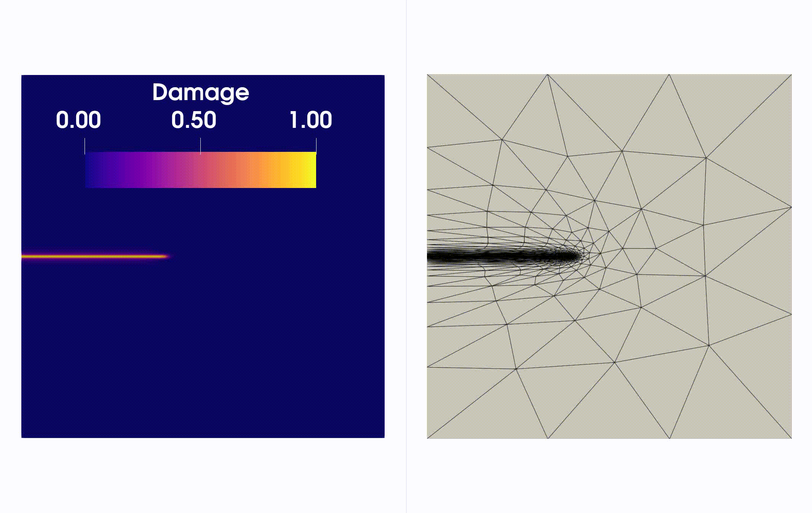

# Phase-Field Model for Fracture in Viscoelastic Solids under Antiplane Displacement

## Overview

This repository contains the numerical implementation of a phase-field model for crack propagation in Zener-type linear viscoelastic solids under antiplane displacement conditions.

The model is formulated using a variational approach and the microforce balance framework, with particular attention to thermodynamic consistency and energy dissipation.

## Mathematical Model

The proposed formulation considers:

- Zener-type linear viscoelastic constitutive behavior.
- Antiplane displacement (Mode III fracture).
- Phase-field regularization based on the Ambrosio-Tortorelli AT2 model.
- Coupling between the damage variable and the viscous internal strain.
- Thermodynamic analysis based on the Clausius-Duhem inequality.

## Numerical Implementation

The numerical simulations are implemented using **FreeFEM++** with the adaptive finite element method (AFEM).

The main simulation files are available in the `FreeFEM` directory.

## Repository Structure

- `FreeFEM/`: FreeFEM++ source codes.
- `Manuscript/`: LaTeX manuscript and bibliography.
- `Videos/`: Animations of crack propagation.
- `Results/`: Numerical results and figures.

## Numerical Simulations

### Example Crack Propagation from a Single Initial Crack
This example illustrates the evolution of crack propagation starting from a single initial crack.

  

---

### Example Interaction and coalescence of two cracks under antiplane loading
This example illustrates the interaction and coalescence of two initial cracks during crack propagation under antiplane loading.!

  

## Requirements

- FreeFEM++
- ParaView (for visualization, if required)

## Usage

Download or clone this repository and run the main FreeFEM++ source file to reproduce the numerical simulations.

## Citation

Sayahdin Alfat, et al., *On Preserving Variational and Thermodynamic Consistency in Modeling Fracture of Zener-Type Viscoelastic Solids under Antiplane Loading*, submitted to [Communications in Nonlinear Science and Numerical Simulation](https://www.sciencedirect.com/journal/communications-in-nonlinear-science-and-numerical-simulation).

## License

Please refer to the license information in this repository.
